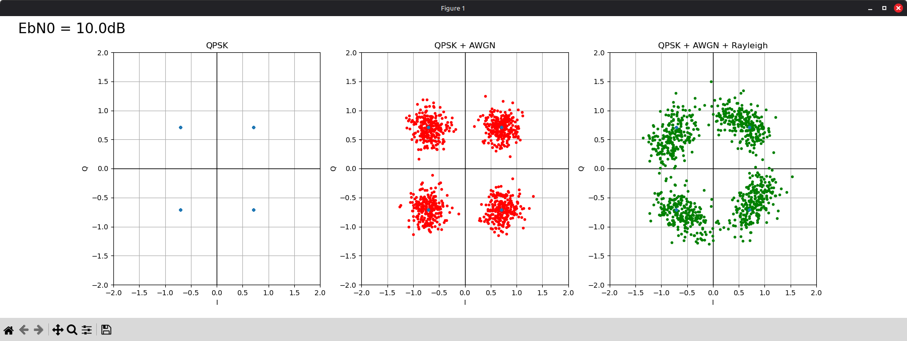

# Tímový Projekt 2026/2027 - PySDR

Dostupné digitálne modulácie:
- BPSK
- QPSK

Program bere dva argumenty
- 1. je Eb/N0 alebo SNR v decibeloch
- 2. počet modulačných stavov (2 alebo 4)

Zdroj: https://www.pysdr.org/

## Vzor výstupu programu

